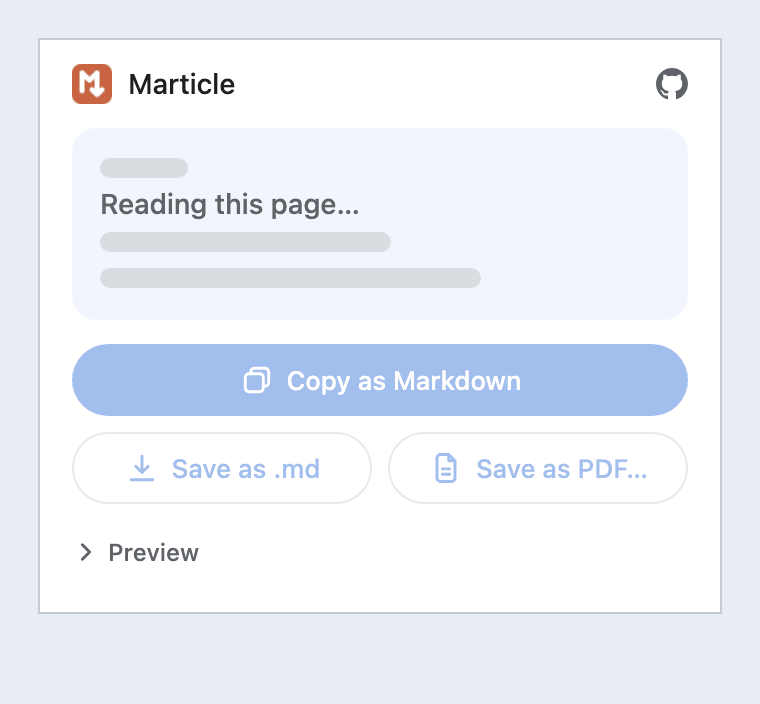

<p align="center">
  
</p>

<h1 align="center">Marticle</h1>

<p align="center"><strong>Copy that.</strong> One click turns any X post, thread or Article into clean Markdown, or a PDF.</p>

<p align="center">
  <a href="https://github.com/albert-mr/marticle/actions/workflows/test.yml"></a>
  
  
  <a href="LICENSE"></a>
</p>

<p align="center">
  
</p>

## Why

Good things on X are stuck inside X. Screenshots throw away the text. Select-all drags the sidebar along. A link is
useless to a model that can't open it. Marticle grabs the actual post, thread or Article, keeps the formatting, and puts
Markdown on your clipboard. Paste it into Claude, ChatGPT, Obsidian, or a plain text file.

## Install

Marticle is distributed here rather than on the Chrome Web Store. Load it as an unpacked extension:

1. Download the zip from the [latest release](https://github.com/albert-mr/marticle/releases/latest) and unzip it. (Or `git clone` this repo and use its `extension` folder.)
2. Open `chrome://extensions`, turn on **Developer mode**, click **Load unpacked**, and pick the unzipped folder.
3. Pin Marticle from the puzzle-piece menu so it's one click away.

Works in any Chromium browser: Chrome, Brave, Edge, Arc.

## Use

Open a post, a thread or an Article on x.com (click a post's date to open it in its own tab) and click Marticle,
or press `Alt+Shift+M` (change it at `chrome://extensions/shortcuts`).

- **Copy as Markdown** puts it on your clipboard. It is the default button, so Enter works too.
- **Save as .md** downloads a file named after the title.
- **Save as PDF…** opens a print-ready page laid out like X, and Chrome's print dialog. Pick **Save as PDF** as the
  destination (and turn off *Headers and footers* once; Chrome remembers both).
- **Preview** shows exactly what you'll get.

The popup and the PDF page are dark, in Chrome's own style. The PDF itself is always a white page.

## What you get

- Author, publish date, and source URL at the top (plus the title, for articles)
- **Posts**: the text with its line breaks, links, hashtags and emoji; images as direct full-resolution URLs; videos as a
  thumbnail plus a link; quoted posts as quoted blocks; polls and link cards as text
- **Threads**: the post you opened plus every post the same author added around it, separated by rules. X only keeps
  the posts near your screen on the page, so for a long thread Marticle scrolls through it, collects every post, and
  puts the page back where it was.
- **Replies**: the whole conversation above them, each post as a quoted block with its own quoted post nested inside
- **Articles**: headings, bold, italic, strikethrough, links, quotes, lists, code blocks, tables, math, images with alt
  text and captions, embedded posts
- Nothing is transcribed or invented; videos stay links.
- PDF: the same content laid out like an X post or Article, with the author, date, images and clickable links.

Marticle copies what X shows. If a long post shows **Show more**, click it, then open Marticle again. X shortens long
quoted posts with "…" and Marticle warns when it sees one: open the quoted post and copy it on its own for the full text.
Image links don't attach the actual images to an AI chat; upload those separately when the model needs to see them.

## Privacy

Marticle reads the current tab only when you click it, converts the page in memory, and hands you the result. To read a
long thread it may scroll the page, then scrolls it back.
It makes no network requests of its own and stores nothing. The PDF view loads images from X's image servers, exactly
as x.com does, so Chrome can print them.

Permissions: `activeTab` and `scripting` to read the open page, `clipboardWrite` to copy it.

## Development

```sh
npm ci
npm test
```

The extractor is `extension/extract.js`, one self-contained function that Chrome injects into the X tab.
The popup is `extension/popup.js`. The PDF view is `extension/print.js`, which renders the Markdown with a vendored
copy of [marked](https://github.com/markedjs/marked) (`npm run vendor` refreshes it). Tests run against fixture DOMs
in jsdom. Pull requests welcome.

## Credits

The extraction and Markdown conversion were adapted from [X Article Export](https://github.com/everettjf/x-article-export-pdf) by everettjf (MIT).
X's DOM structure was cross-checked against [Defuddle](https://github.com/kepano/defuddle)'s test fixtures.
The PDF view renders Markdown with [marked](https://github.com/markedjs/marked) (MIT).
The icon is a nod to the public-domain [Markdown Mark](https://github.com/dcurtis/markdown-mark).

[MIT](LICENSE) © Albert Martinez. Not affiliated with X Corp.
